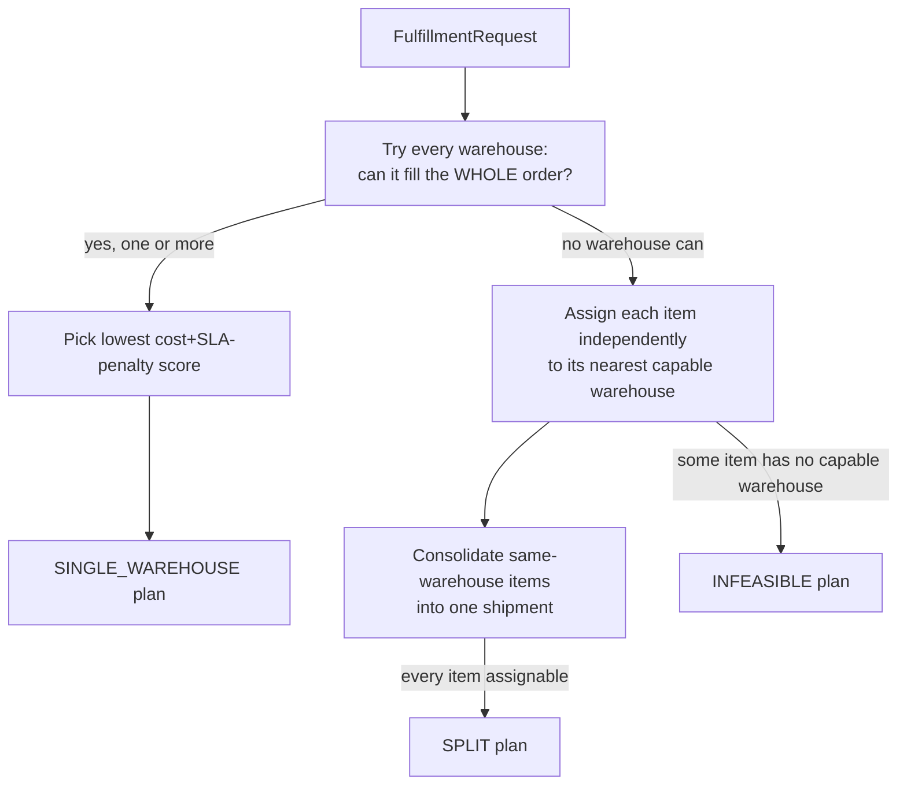

# Architecture

## Decision Flow



### ASCII fallback

```
FulfillmentRequest (customerCity, items, requestedSlaDays)
        |
        v
For every warehouse: does it have ALL items in sufficient stock?
        |
   yes, 1+          no warehouses qualify
        |                    |
        v                    v
Score each by cost + SLA-miss penalty     For each item independently:
Pick lowest score                          nearest warehouse with enough stock
        |                                          |
        v                              some item unassignable?  all assignable?
SINGLE_WAREHOUSE plan                        |                        |
                                              v                        v
                                        INFEASIBLE plan     consolidate same-warehouse
                                                             items into shipments
                                                                       |
                                                                       v
                                                                  SPLIT plan
```

## Components

| Component | Responsibility |
|---|---|
| `NetworkDataRepository` | Loads warehouses/products/inventory/cities once, serves from memory |
| `FulfillmentOptimizerService` | The full decision flow above — Haversine distance, cost/SLA scoring, both strategies |
| `FulfillmentController` | `POST /api/fulfillment/plan` plus reference-data endpoints |

## Important Interfaces

- Haversine distance is computed directly (no external geo library) —
  standard great-circle formula, verified against known real city-pair
  distances (Mumbai–Delhi ≈ 1,153 km, Bangalore–Chennai ≈ 290 km) before
  being trusted for the rest of the algorithm.
- Split-fulfillment consolidation matters: if two different items both
  route to the same nearest warehouse, they become **one** shipment (one
  base shipping cost), not two — see the dedicated test for this.

## External Dependencies

- Spring Web, Spring Validation (runtime)
- Spring Boot Test (JUnit 5, AssertJ — test scope only)
- No optimization library (OR-Tools, etc.) — see docs/design-decisions.md
  for why a greedy, explainable algorithm was the right fit here

## Decision Points

- **Greedy nearest-warehouse assignment for split fulfillment, not a true
  global optimum.** A real multi-item, multi-warehouse allocation with
  capacity constraints is a combinatorial optimization problem; solving it
  exactly needs a proper solver. The greedy per-item nearest-capable-warehouse
  rule is fast, fully explainable per item, and good enough at this
  network size (6 warehouses) — see docs/design-decisions.md for the
  explicit trade-off and when a real solver would be worth it.
- **SLA is scored as a penalty, not a hard filter.** A warehouse that
  narrowly misses the requested SLA is still a valid candidate (better than
  no plan at all) — it just scores worse than one that meets it, and the
  response's `slaStatus` tells the caller plainly whether the chosen plan
  meets the request.
